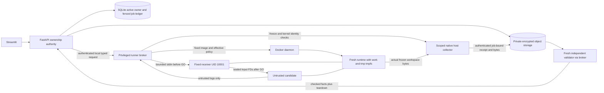
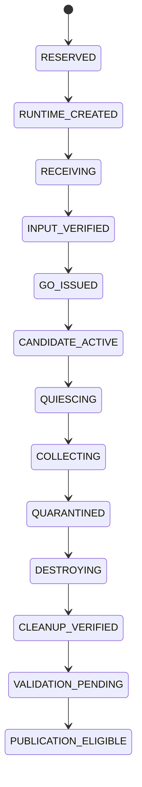

# Step 7I: secure input/output transport design

Status: design proposal, not an implemented or approved transport. Reviewed on
2026-10-23 after checkpoint `38ec7814e5e314cd58b9f28633f900c701cb2a1b` was committed
and pushed to GitHub main. Local/remote hashes matched and the working tree was
clean before this document. No container was created, started, paused or executed
for this investigation. No real uploads, runtime APIs, policy changes, new image,
cloud provisioning or inference credentials are enabled.

Step 7J approves only transport-neutral synthetic validators and fake preparation
tests, **not** the amendments or actual transport recommended here. See
[the implemented validation subset](runner-transport-validation.md). The following
receiver/memfd/freezer/collector mechanisms remain proposals; no such mechanism
has been implemented or runtime-verified.

Decision: do not implement Options A or C as an archive shortcut. Recommend
**Option B input plus an Option D host-side collector, conditionally**, subject
to explicit PRD amendment approval and native Linux security experiments. If the
literal stopped-archive/root-owned-input requirements must remain unchanged,
this recommendation cannot proceed; the alternate OCI-preparation approach below
needs a separate architecture review. No currently reviewed option proves the
complete original contract operational using the existing Docker adapter.

## 1. Original contract and current implementation

The supplied 26-page PRD, version 1.0 dated 19 October 2026, was read locally.
Source SHA-256: `999d923deb24960418fc94afbaaab4ce195636be25d0f05dd384129ef077d889`.
Extracted text is an ignored audit artifact, not a replacement PRD.

- Pages 8-9 separate orchestration, runtime broker and deterministic validator;
  only the broker controls the runtime through a private channel.
- Page 11, SEC01-SEC10: UID/GID 10001, no capabilities/privilege, network none,
  read-only root, only bounded /work and /tmp tmpfs, tested syscall/LSM isolation,
  explicit environment, resource limits, fresh runtimes and verified teardown.
- Page 12 explicitly specifies copying selected data, fixed metadata and source
  into a **fresh stopped container via runtime archive API**, with **root-owned
  read-only inputs**, followed by starting a fixed bootstrap. Collection is
  before shutdown, after candidate descendants stop, with output treated as
  untrusted bytes. Generated stdout is not trusted control evidence.
- Pages 13-15: admitted run deadline 180 seconds including transfer/validation/
  cleanup; candidate wall/CPU limits 20/10 seconds; validator wall 10 seconds;
  originals 20 MiB, normalized input 100 MiB; quarantine, independent validation
  and teardown precede atomic publication.
- Page 14 workbook checks remain independent: <=1,000 archive entries, <=100 MiB
  actual/declared expansion and <=100:1 compression ratio, verified in isolated
  ingestion. Uncompressed transport does not make XLSX internals safe.
- Page 19: maximum one-hour sessions, application-copy deletion within five
  minutes of expiry/request, encrypted private storage, no content backups or
  snapshots, avoid private data in swap/crash dumps; separate minimal audit policy.

These PDF statements are requirements, not additional authorization to execute
their lifecycle or build code in this design-only step. The user's current scope
controls what is performed.

Current code is narrower: policy.input_transport is `stopped-container-archive`,
OpenStdin/StdinOnce are false, TTY is false, the image runs only the fixed smoke
fixture as 10001, and the transport has fake-tested create/inspect/remove only.
The bootstrap receives no input and has no general executor, supervisor or
collector. No real lifecycle transport exists. Step 7G's image identity is for
static selection, not execution; final_image_digest remains None and the execution
gate always rejects. Step 7H retains `LSM_NOT_ADVERTISED` on local Desktop and
native Linux acceptance PENDING. None of those gates changes here.

Existing private storage already binds opaque objects to active sessions/runs,
hashes bounded bytes, reserves STAGING before I/O, seals only after rechecking
ownership, and refuses publication. The single LifecycleCoordinator already
revokes sessions, cancels runs, fences cleanup leases and verifies storage/WAL
cleanup. New transport must integrate those components, not replace them or
pretend their future runner hooks already attest real runtime removal.

## 2. Evidence ledger: documented facts versus hypotheses

Official sources were consulted on 2026-10-23. Moby links below are reviewed
**master source**, not an asserted match to the installed Engine 29.9.1 build.
The requested version-tagged archive source was not retrievable. Master's API
schema currently describes 1.57; the existing runner stays pinned to API 1.56.
Before any real transport approval, obtain the deployed daemon source revision,
review its matching API/spec/code and run separately authorized synthetic probes.
Source analysis is not local runtime acceptance.

| Question | Evidence / conclusion | Status |
| --- | --- | --- |
| Does cp support stopped containers? | Docker CLI documents both running and stopped targets and tar streams. This says nothing about a particular destination being writable or sharing the runtime's tmpfs. | Documented API surface, not proof of this design |
| Can archive PUT populate a read-only root? | Reviewed Moby extraction calls checkWritablePath; paths outside writable registered volumes are rejected when ReadonlyRootfs is true. No accepted volume exception exists in current policy. | Source-confirmed restriction in reviewed implementation |
| Does writing through archive into /work reach live tmpfs? | Reviewed containerFSView has private tmpfs mounts whose contents are not shared with container processes. Live archive GET has the same filesystem-view concern. | Source-confirmed separation; exact deployed behavior still needs matching-build tests |
| Does pre-start root data appear through /work tmpfs? | Mounting tmpfs obscures underlying files. | Documented; cannot use underlying layer as input transport |
| What survives stop/restart/removal? | Docker removes tmpfs on stop; restarted runtime must not be treated as retaining it. Permissions can change on restart. Removal is not a recovery mechanism for tmpfs bytes. | Documented lifecycle, no restart/resume assumption |
| Who owns copied input? | Docker cp normally assigns root in-container ownership, but that is neither destination immutability nor evidence of runtime visibility. Archive metadata may carry hostile modes/owners. | Documented defaults; explicit server-owned metadata still required |
| Can attach transfer bytes? | Docker supports stdin/stdout/stderr attachment, with flow-control buffering. It carries process bytes, not authenticated application completion. | Documented transport; security protocol is our proposed design |
| What accounts for tmpfs? | Docker documents tmpfs against the memory cgroup, with possible host swap persistence. Workspace quota does not increase the 1 GiB RAM allowance. | Documented, effective enforcement still UNVERIFIED |

Sources supporting the ledger:
[Docker cp, including tmpfs corner cases](https://docs.docker.com/reference/cli/docker/container/cp/),
[Moby archive write checks](https://raw.githubusercontent.com/moby/moby/master/daemon/archive_unix.go),
[Moby private filesystem views](https://raw.githubusercontent.com/moby/moby/master/daemon/containerfs_linux.go),
[Docker tmpfs lifetime and accounting](https://docs.docker.com/engine/storage/tmpfs/),
[Docker attach and backpressure](https://docs.docker.com/reference/cli/docker/container/attach/).

Inferences: moving PUT until after start does not resolve the private-view
problem; GET after exit cannot recover live tmpfs. Writable root during seeding
followed by updating configuration is not an approved sequence, and no reviewed
Engine API sequence was demonstrated to make it safe. No inference here permits
host bind mounts, shared/unrestricted volumes or a secret-bearing per-job image.
Rootfs/image layers, daemon logs, temporary archive views, host client buffers,
swap and crash dumps are all potential application-copy locations requiring
bounded retention evidence; a successful HTTP request or remove response cannot
certify their absence.

## 3. Alternatives and PRD compatibility

| Option | Input / output route | Principal limitations | Decision |
| --- | --- | --- | --- |
| A: stopped archive preparation | PUT archive before start; bounded stream out while alive | Read-only-root rejection and separate tmpfs view; putting input in the lower layer is obscured and may create host-persistent private content. No proven read-only-after-seeding transition. | Reject for current Engine/policy; closest literal wording, not shown feasible |
| B: trusted bootstrap stdin | Start fixed receiver, stream bounded bytes, launch candidate only after admission | Different timing from PRD; UID 10001 cannot create UID 0 files without forbidden privilege. Same-user supervisor messages/keys are not a safe post-launch authority. Needs immutable FD inputs and external collection. | Recommended input route only, conditional on amendments |
| C: controlled live archive | PUT/GET while fixed receiver/runtime is alive | Same archive tmpfs/private-view issue; writable target and UID rules remain. Exec-ing tar is a different transport with extra commands/decoders and live-race exposure, not an archive API fix. | Reject as default; do not experiment around gates |
| D1: runtime-managed stopped OCI preparation | Broker prepares a private snapshot or memory-backed root, installs validated root-owned files, seals before launch | Could preserve original semantics but changes executor/privilege boundary; private snapshots can persist. Memory accounting, erasure, collector access and supported APIs remain unproven. Never edit Docker's private layer directories. | Alternative if literal stopped archive is mandatory; separate architecture approval |
| D2: native host collector | Broker pauses entire runtime; narrowly scoped trusted helper reads the actual runtime workspace before destroy | Requires native daemon-host access, verified freezer/cgroup/PID binding and safe descriptor traversal. More privileged trusted code, unavailable through current Windows client. Not a general host path API. | Recommended output route with B, conditional on review/probes |

No network listener, Docker socket inside the guest, sidecar shared volume,
host bind, root/capability exception, runtime package download or user-image
build is an acceptable substitute.

## 4. Proposed approval boundary and threat model

Required amendments, **not yet approved**:

1. Replace page 12 stopped archive delivery with a fixed receiver running before
   any untrusted candidate; input arrives over broker-owned attach stdin.
2. Replace root-owned input path semantics with sealed anonymous file descriptors
   owned by UID 10001. A same-owner chmod-0444 file is insufficient: its owner can
   change its mode. No claim that a non-root receiver can chown files to root.
3. Approve the scoped native host collector and clarify page 12 quiescence:
   freeze all candidate descendants during collection, then destroy the runtime.
   If actual termination of every candidate descendant before collection is
   required, the selected isolation/supervision arrangement must prove that
   separately; freezing is not a claim that those processes have exited.

SEC01-SEC10 remain mandatory. Starting a receiver is still a real restricted
runtime with all applicable controls, never an unconfined staging exception.
The proposed process/environment/image/stdio contract needs a new explicit
policy version and separately built/reviewed image. No current pin is silently
reused for changed image bytes, and no settings are changed in this milestone.

Assume hostile user content, code, filesystem entries, output bytes, stdout,
malformed framing and every identifier a client can supply. Trust only the
authenticated ownership authority, protected broker/journal, verified runtime
and narrowly scoped host collector. Host administrator/kernel/daemon compromise
can defeat this boundary; do not market it as production-grade containment.
The broker has high host authority; OS access control and minimal RPC surface
are prerequisites, not consequences of a typed Python interface.



The helper's control channel is host-local and inaccessible to guest code; it is
not a network service or socket mounted into a container. API/Streamlit never
receive daemon authority. Validator uses a fresh sandbox and reviewed validation
code, not generated code or a model's opinion.

## 5. Proposed bounded input protocol

Authenticate the operator/service peer on a protected local channel; resolve
session/run/attempt from server-owned records and check expiry, source version,
candidate hash, active lease generation, budgets and cancellation. A SHA-256
alone authenticates neither a sender nor an owner. Bind the immutable manifest
to session/run/attempt, job nonce, fencing epoch, image/policy/build identities,
source hash and selected schema/sheet. Those fields are server-issued, not
container-provided authorization. No session token, inference/storage key or
host credential enters the guest.

Proposed wire profile for later approval/tests:

- Versioned binary framing; header <=64 KiB, strict typed manifest with no unknown
  fields/duplicate keys, <=16 input objects, opaque object/role IDs only. No
  supplied host path, executable command or runtime option. No compression.
- Objects are fixed-role flat byte sequences with declared size/hash. Parser:
  original <=20 MiB. Candidate: normalized selected table <=100 MiB and candidate
  source <=10 MiB. Validator: original <=20 MiB and quarantined artifacts <=20
  MiB total. Fixed job metadata <=64 KiB. Role-specific allowlists reject extra
  inputs; not every role can request every maximum simultaneously.
- Aggregate payload <=110 MiB +64 KiB metadata; wire <=110 MiB +128 KiB including
  the manifest. Data chunks <=64 KiB, with exact sequence/count derived from
  declared lengths; proposed maximum 1,800 data frames. No zero-progress frames,
  duplicate delivery into a live receiver, trailing bytes or in-stream commands.
- Proposed transfer deadline <=10 seconds and idle deadline <=1 second, further
  reduced by remaining run time/retention. These are upper bounds, not retries
  or deadline extensions. Header/length limits apply before allocating buffers.
  Cap broker and daemon buffering independently and bound concurrent jobs.
- After receiving **all** expected objects, verify actual lengths/hashes, create
  sealable memfds and require write/grow/shrink/seal seals. No writable mappings
  or candidate-supplied seals are accepted. Verify seal bits and length before
  forwarding read-only capabilities. Apply a minimal exec environment and close
  every unrelated descriptor. Input bytes are not parsed as CSV/XLSX or executed
  by the receiver. Parsers stay inside their own restricted job.

Sealing is a proposed immutability primitive, not a tested integration. Linux
documents anonymous memfd files and sealing; actual seccomp compatibility,
FD lifecycle, cgroup accounting and Python-library FD support need experiments.
[Linux memfd interface](https://man7.org/linux/man-pages/man2/memfd_create.2.html).

Proposed fixed stdio fields are OpenStdin/AttachStdin/AttachStdout/AttachStderr
true, StdinOnce true, TTY false, with daemon log driver none. These differ from
the present smoke spec and require review, not caller overrides. Establish/drain attachment
before starting the fixed receiver, with log replay disabled and independent
bounded stdout/stderr readers, and prove pre-start attach/half-close semantics
against the pinned Engine. Full-duplex backpressure and disconnects are not
handled by concatenating writes or calling communicate with unbounded buffers.

The pre-candidate trust window is deliberate: after measuring all input, the
receiver creates a fixed launcher child blocked on a private gate, without
interpreting candidate code. Before READY/GO, the host must register and verify
that still-trusted task's kernel identity. Broker rechecks ownership/lease and
authorizes one GO. Receiver closes control input and releases the launcher to
exec the fixed interpreter with sealed input/source FDs and capped log pipes;
the PID 1 receiver stays alive but is no longer a trusted evidence authority.
No control/key descriptor is inherited by the candidate. Exact half-close and
child-registration behavior must be proved before use. No reattach/resume.

**After GO, every guest message is untrusted log data.** DONE/READY-looking
bytes, nonces, hashes or an exit code cannot advance durable phases, attest
cleanup or publish results. No authentication key is placed in the guest; an
HMAC key in a same-UID supervisor's environment, inherited memory or descriptors
would not establish an independent boundary. Receiver tampering after GO causes
no false completion authority because lifecycle/collection evidence comes from
outside. Its survival must not be relied on for safety.

Same-UID bootstrap/candidate separation is temporal, not a newly claimed OS
security boundary. Sealed inputs cannot become writable merely by chmod, but
candidate access to inherited FDs/proc must still be tested. Receiver code and
framing are trusted, memory-safe/bounded code; malicious object bytes cannot be
interpreted as early GO/READY. Candidate crashes or kills of PID 1 lose outputs
and fail closed rather than granting a successful collection.

## 6. Artifact collection before destroy

1. Before GO, reserve the runtime/job inventory durably. A future helper must
   register/verify candidate identity while the fixed launcher is still trusted,
   using kernel PID/start identity, namespace and cgroup membership with pidfds.
   A guest PID string or command name alone is insufficient. The exact mapping
   and descendant tracking interface is a release blocker, not implemented here.
2. A host-observed candidate leader exit may trigger quiescence, not completion.
   Surviving descendants remain hostile. Pause the **whole** container and
   require effective cgroup frozen evidence, verified runtime ID, pinned init
   task/cgroup/namespace identity and unchanged fence. A requested pause flag or
   pidfd readiness for one process is insufficient. No background sibling can
   write during collection; uncertainty aborts collection.
3. A narrowly scoped host helper opens the actual runtime root/workspace from
   validated kernel runtime references, not the Docker archive filesystem view.
   Proposed Linux /proc task-root access is a trusted kernel magic-link boundary;
   it must be pinned against PID reuse and namespace swaps. After that single
   reviewed boundary, all untrusted path descent uses directory FDs/no-follow.
   Verify /work is the intended runtime tmpfs. No guest-provided path/PID/cgroup,
   arbitrary host file reads, mount creation, nsenter command or guest exec.
4. Enumerate only flat /work/output, <=10 allowlisted expected entries. Proposed
   names: `a_<32 lowercase hex>.(csv|png|json|txt)` issued in trusted job metadata.
   Never use a label/original filename as a host path. Reject unknown entries,
   directories, absolute/drive/UNC paths, separators, dot segments, Unicode
   aliases, alternate streams, symlinks/hardlinks, devices, sockets and FIFOs.
   Verify regular-file type, link count one and bounded logical size before
   reading; recheck opened descriptor metadata and EOF. No recursive tar
   extraction, shell, decoder or data-format parser in the privileged helper.
5. Enforce <=10 MiB/file, <=20 MiB total, <=10 files; header/manifest/entry counts
   also bounded. Compute host-side actual bytes/hash; container manifests and
   reported hashes are only untrusted claims to compare. Drain/log separately
   with 64 KiB caps per stream; never let logging consume artifact allowance or
   deadlock transfer. Unknown/sparse/archive encodings are not decoded here.
6. Stream directly into existing private quarantine STAGING objects in <=64 KiB
   chunks with a real interruptible transport deadline. Existing storage's
   between-chunk timeout cannot preempt a blocked producer by itself. Seal only
   after exact length/hash and active owner/fence checks. Any partial collection
   invalidates the whole candidate result; retain only scoped cleanup inventory.
7. Close host root/file/mount-pinning descriptors and all stream readers, destroy
   the runtime and verify absence/process termination. Open descriptors can keep
   ephemeral data alive: force-remove alone is insufficient. Never leave a
   paused runtime for later recovery. Obtain independent validation in a new
   runtime, collect and destroy it too, then publish atomically under an active
   owner/fence after all validation and cleanup evidence reconciles.

Kernel freeze requests complete asynchronously; the frozen state must actually
be observed. See [cgroup v2 freezer evidence](https://docs.kernel.org/admin-guide/cgroup-v2.html).
Native helper access, trusted PID registration, namespace/mount visibility,
kernel permissions/LSM and descriptor cleanup remain **hypotheses to verify**.
No host traversal through /proc was implemented or attempted. A native daemon
host is necessary; the current Windows Docker client cannot provide that view.

Proposed collection deadline <=5 seconds and always inside the 180-second run
budget with cleanup reserve. On timeout/cancellation/resource violation, do not
delay whole-runtime kill to salvage artifacts. Preserve the 20-second candidate,
10 CPU-second and 1 GiB limits, 32 PIDs, two-second over-deadline kill and separate
five-second cancellation target. Pausing is not permission to extend limits.
Input memfds, tmpfs, code, pipes and trusted receiver also consume memory; prove
all accounting and VM concurrency headroom, not only requested mount sizes.

## 7. Required future APIs and implementation changes

These are design requirements, not commands enabled by this milestone:

| API / interface | Narrow purpose |
| --- | --- |
| Existing context, version/info and image inspect | Static selection and unchanged host/runtime prerequisites |
| POST /v1.56/containers/create; GET .../{id}/json | Fixed immutable spec, identity/effective metadata |
| POST .../{id}/attach; POST .../{id}/start | Fixed receiver stdin, bounded non-TTY log streams |
| GET .../{id}/stats; POST .../{id}/wait | Resource observations; container stop is not artifact success |
| POST .../{id}/pause; POST .../{id}/kill | External quiescence or unconditional bounded termination |
| DELETE .../{id}; GET .../json; scoped inventory | Verified removal and orphan reconciliation, not global prune |
| Host kernel cgroup/PID/root-FD interfaces | Trusted task binding, freezer evidence and actual tmpfs collection |

Archive HEAD/GET/PUT endpoints are evaluated alternatives, not part of the
recommended payload route. No exec, container commit/export, unpause-for-copy,
restart/resume, pull, build, volume or arbitrary command API is needed. The
current schema/API allowlist must not be broadened until separately approved.
Docker's non-TTY attach framing has its own multiplexed stream headers; a later
reader must bound and validate those **before** any application framing and
handle arbitrary socket fragmentation. Frame lengths cannot trigger unbounded
allocation. See [official Engine API 1.56](https://docs.docker.com/reference/api/engine/version/v1.56/)
and [Moby API schema](https://raw.githubusercontent.com/moby/moby/master/api/swagger.yaml).

Proposed code, after approval only:

- New pure `runner/transport_protocol.py`: immutable role/manifest limits,
  framing/length/hash checks, no OS or Docker calls.
- New `runner/transport_state.py`: fenced phase definitions and recovery rules;
  no creation capability implied by a parsed manifest.
- Later fixed receiver/image revision and typed Docker lifecycle adapter methods;
  explicitly reviewed stdin/launcher contract and a new image/policy identity.
- Separate minimal native `runner/collector` service/helper, authenticated
  owner/fence-scoped host RPC, no public path-based interface. Language, privilege
  narrowing and kernel mapping require security review before implementation.
- Later new numbered database migration for durable runner inventory/transport
  phases and monotonic fencing epoch; never edit migrations 1-4. Reuse run/attempt
  ownership, private storage registry and the one LifecycleCoordinator. No new
  public upload/transport endpoints until all release gates pass.

The current runs lease fields are groundwork, not a complete fenced worker
implementation. In-memory DockerLifecycleAdapter receipts and Python objects
cannot substitute for a durable job journal or process reaper.

## 8. Durable flow, idempotency and failure handling

Proposed transport substate journal (not new existing run-state strings):



Every phase can branch to ABORTING -> DESTROYING -> INTERRUPTED/FAILED with
quarantine; failed absence verification produces CLEANUP_UNRESOLVED and pauses
admissions. PUBLICATION_ELIGIBLE is not COMPLETE: active ownership, independent
validation-runtime cleanup and the final transaction are still required.

Persist intent and resource identity/labels **before** external operations;
reconcile ambiguous outcomes after them. Bind session/run/attempt, source/code
hashes, immutable policy/image IDs, job nonce, lease generation, deadlines and
container inventory. CAS updates require the current unexpired lease and active
owner. Stale workers cannot seal/publish. Lease loss cancels outstanding I/O and
requires teardown/reconciliation before another job; a fence cannot retroactively
unsend GO or make an in-flight daemon create atomic with SQLite revocation.
Meet bounded cancellation and reject all late publication instead of promising
instantaneous external-process atomicity.

Same idempotency key plus same immutable request returns the existing status;
different content conflicts. Duplicate GO/phase advancement is refused. Do not
resume partial streams or restart containers. After restart/ambiguous delivery,
mark the attempt interrupted and reap its exact labeled runtime; do not silently
rerun code. Any later explicitly authorized fresh attempt must fit original
version/attempt/time budgets after verified prior cleanup. No unlimited retry,
sleep-based recovery or extended session/deletion deadline.

| Failure | Required response |
| --- | --- |
| Partial input/EOF | No GO; invalidate receiver, destroy, keep truthful failed transfer inventory |
| Wrong hash | No GO; SECURITY_FAILURE, quarantine status, never substitute another source |
| Oversized/header/frame count overflow | Reject before allocation or dispatch, close stream, terminate receiver |
| Broker disconnect | Independent watchdog cancels runtime; no stream resume or implicit success |
| Container crash | Inputs/output tmpfs may be gone; reject result, verify disappearance and pending host copies |
| Candidate timeout | Whole-runtime kill within policy deadline; no collection delay, no valid output claim |
| Output/log overflow | Artifact overflow fails result; logs stop at cap with sanitized overflow event and bounded draining/termination |
| Malformed archive | Any alternate archive/parser rejects invalid, compressed, sparse, duplicate, link/special entries before extraction; no generic extractall |
| Symlink/path traversal | Reject output/manifest, no target read or deletion; abort and scoped runtime teardown |
| Artifact collection failure | Keep partial STAGING unpublishable; invalidate set, cleanup through registered refs |
| Cleanup failure | Preserve CLEANUP_UNRESOLVED, quarantine worker, stop admissions and alert; never fake receipt |
| Docker outage | Persist uncertainty; watchdog/helper handles what it can independently; remain blocked until verified reconciliation |
| Worker restart during collection | OS closes helper FDs; discard incomplete set, reap runtime, mark INTERRUPTED; frozen output is not a durable checkpoint |
| Duplicate delivery/retry | Return durable status or conflict; never dispatch twice or trust stale fence; fresh attempt only after scoped verified cleanup |

Existing cleanup request deadlines remain requested_at +300 seconds; session
access remains <=1 hour. A missed deadline remains a recorded miss. Preserve
24-hour minimal security metadata and <=30-day content-free aggregates; detailed
content/manifests/hashes linked to sessions follow session retention. No raw
filenames, data, code, input frames or credentials in operational audit logs.
Retained quarantine/partial files are registered private application copies, not
an exception to deletion policy. Removal does not certify physical/provider
erasure or lost data in swap/dumps/backups.

## 9. Bounded test plan and acceptance gates

The original Step 7I design added no parser/runtime implementation or tests merely
to assert document text. Step 7J now covers a smaller synthetic validation subset;
remaining future tests must exercise real policy properties:

| Layer | Fixed bounded cases / required evidence |
| --- | --- |
| Pure manifest/framing | Role limits at boundary and +1; <=16 objects/1,800 frames; header bounds; overflow/negative/bool lengths; duplicate/unknown fields; ordering, truncation, trailing data, hash mismatch; payload containing READY/GO text is inert |
| Ownership/state fakes | Cross-session/run/source, stale epoch, duplicate GO, revoked owner before/after I/O, two claimants, ambiguous create, restart at every phase; no duplicate publication or deadline extension |
| Stream fakes | Short reads/writes, all single boundary splits and bounded seeded fragmentations, backpressure, half-close, cancellation, disconnect, oversized Docker frames, log flood; hard memory/time budgets, no real sockets/containers |
| Collector interface fakes | Forged guest DONE/manifest/exit code never advances phase; mismatched runtime/PID/namespace/fence rejected; missing freeze evidence blocks; FIFO/link/sparse/path fixtures do not touch outside canaries |
| Native fixed experiments, separately approved | Exact deployed archive/private-tmpfs behavior, pre-start attach/half-close, memfd seals and same-UID tamper attempts, proc/FD isolation, kernel task registration, all-descendant freeze and actual tmpfs reads, FD release after crash |
| Full runtime acceptance, later | Effective SEC01-SEC10, total memory including memfds/tmpfs, 10 CPU/20 wall seconds, PID caps, cancellation/kill bounds, fresh-state probes, daemon outage/restart recovery, no secret/other-session access, health before/after |

Use synthetic bytes only; no AI-generated code or uploaded spreadsheets for the
first experiments. Later adversarial fixtures must be predefined and bounded,
with synthetic outside canaries, an independent host watchdog and explicit
operator approval. Do not run stress probes against production or accept
requested flags, mock successes or guest stdout as runtime proof.

Release gates: amendments approved; native LSM/seccomp and service permissions
verified; matching Engine source/schema; reviewed minimal image (current shells,
pip and headers still need release review); safe FD input/cgroup accounting;
kernel-bound collector/quiescence; durable fenced job/reaper; bounded transport;
independent validator, encrypted storage/privacy terms and atomic publication.
All remain blocking where unimplemented/unverified. Desktop cannot certify the
Vultr deployment; no VM is provisioned by this design.

Step 7J separately authorizes a pure, smoke-v1-only manifest/framing validator
and fake transport/state harness, recorded in [the validation guide](runner-transport-validation.md).
It does not approve the broader role-bound protocol or either architecture
amendment. No Docker/image/policy activation, host helper, real parser, upload or
execution is added. Actual transport still requires amendment/architecture review.
If amendments are declined, revisit D1 instead; do not disguise B as stopped
archive transport.

## 10. Explicit unresolved questions after Step 7J

| Question | What remains unimplemented/unverified |
| --- | --- |
| Authenticated, bounded stdin? | Pure manifest/frame comparison provides no peer authentication. No attach/stdin adapter, half-close proof, credential-safe local RPC or interruptible I/O exists. |
| Genuinely immutable descriptors? | No memfd/seal implementation or target-kernel/seccomp/seal verification. Root-owned read-only files remain the current PRD requirement. |
| Candidate replacing input? | Byte hashes prove received agreement only. Same-UID chmod/proc/FD replacement and mapping attacks are not tested; no claim that current validation makes input immutable. |
| Output without host privileges in candidate? | Output metadata remains quarantined claims. No candidate gains host authority; no real collector exists to independently measure filesystem/content properties. |
| External freeze proof? | No cgroup freezer integration, all-descendant quiescence receipt or kill-deadline measurement. A fake state transition is not freezer evidence. |
| Reading actual tmpfs across namespaces? | No reviewed, working kernel task-root/mount-namespace mapping or native-host collection experiment; Docker archive's separate filesystem view is not a substitute. |
| Collector privileges? | Exact minimal service identity/capabilities, access-control policy and broker-helper RPC remain to be selected/reviewed; no privileged helper is added. |
| Symlink/namespace/PID-reuse/race attacks? | Metadata rejects unsafe declarations only. No actual no-follow traversal, pidfd/mount binding or frozen-filesystem race proof exists in this milestone. |
| Crash/restart and cleanup truth? | Step 7K adds SQLite claims, epochs and cancellation for fixed synthetic preparation, with no external effects. Standalone simulator state remains in-memory. Durable external intent, watchdog, orphan reconciliation and verified resource cleanup remain unimplemented before real admission. |
| Formal PRD amendments? | Stopped-container archive timing, root-owned input semantics and freeze-versus-terminated-descendant collection require explicit approval; receiver/stdio/image/collector changes are not approved by Step 7J. |

All SEC01-SEC10, LSM/seccomp, private-storage/privacy and independent-validation
release gates remain. The simulator's READY_FOR_EXECUTION label does not change
them. Next review may assess these pure validators; actual transport decisions
still await architecture approval and native Linux acceptance.

## 11. Step 7I verification record (historical)

Checkpoint phase full suite:

```powershell
uv run --frozen --no-sync python -m pytest -q -rs -p no:cacheprovider --basetemp var/step7i-checkpoint-tests-20261023
# 746 passed, 1 skipped, 1 warning in 24.47s
```

Before commit: exact 18 staged paths matched reviewed blobs, credential signature
hits 0, staged diff check passed. Commit message:
`feat: harden runner image admission and assess Linux host readiness`.
Normal push advanced main from 169effb to 38ec781; remote main/local HEAD/
origin-main matched the full hash recorded at the top. No force push.

Step 7I changes only this document and README/runner-plan discovery links. No
implementation, dependencies, published migrations, bootstrap or security gate
changes. The design is intentionally left uncommitted for review. PDF extraction
used an isolated `uv --no-project --with pypdf` tool environment; project Python
environment/lockfile were not modified. No real Docker lifecycle API was called.
Final post-design verification:

```powershell
uv run --frozen --no-sync python -m pytest tests/test_host_readiness.py tests/test_runner_policy.py tests/test_runner_image.py tests/test_runner_preflight.py tests/test_runner_lifecycle.py -q -p no:cacheprovider
# 520 passed in 0.97s
uv run --frozen --no-sync python -m pytest -q -rs -p no:cacheprovider --basetemp var/step7i-design-tests-20261023
# 746 passed, 1 skipped, 1 warning in 30.60s
uv run --frozen --no-sync python -m compileall -q backend runner tests
# exit 0
git diff --check
# exit 0; untracked design-document whitespace also checked
```

The Windows file-symlink privilege skip at tests/test_storage.py:176 and existing
Starlette TestClient/httpx deprecation warning remain visible. Git LF/CRLF
advisories are separate. No automated test failed in either phase. Final remote
main again matched the checkpoint hash. Working tree has only README.md and
docs/runner-foundation-plan.md modified, plus this untracked design document;
nothing is staged. Runtime logs, PDF text, staged audit diff, image archives and
other audit files remain ignored under var/. No runtime source or dependency
changed after checkpoint. Design-only signature/file-scope review found no
unexpected file or credential signature; scans are heuristic, not certification.
